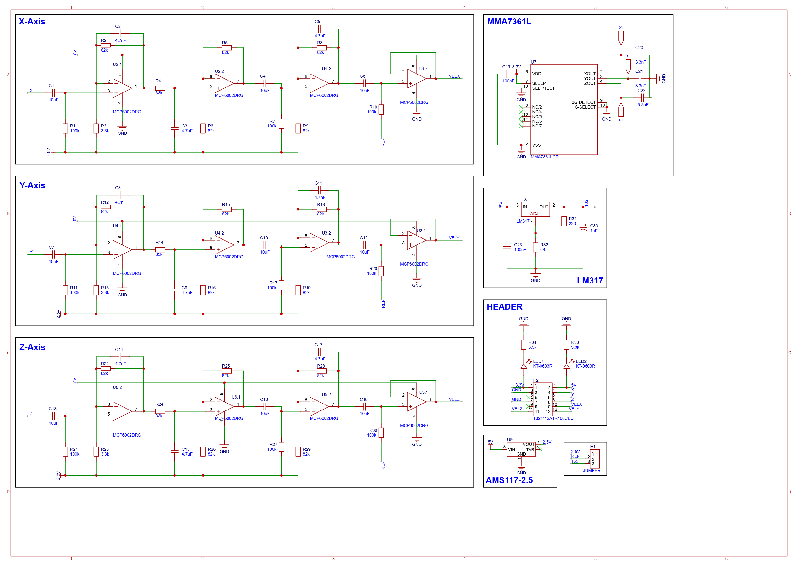
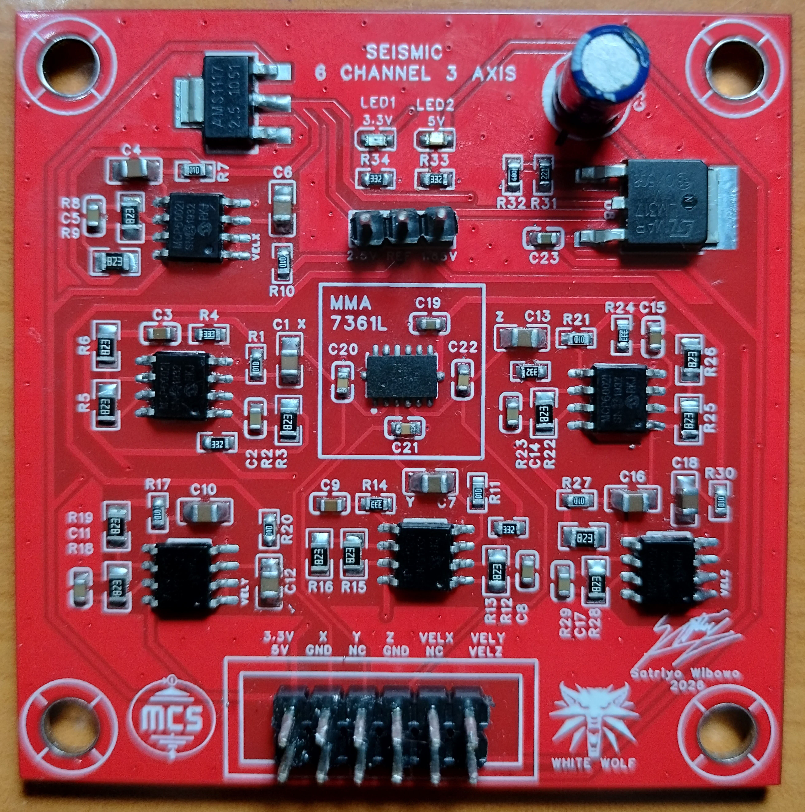
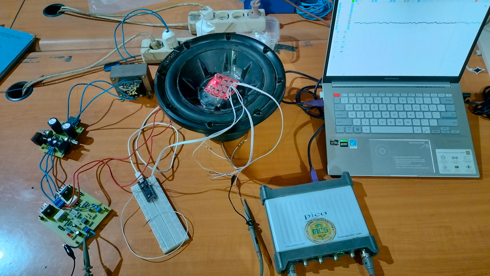
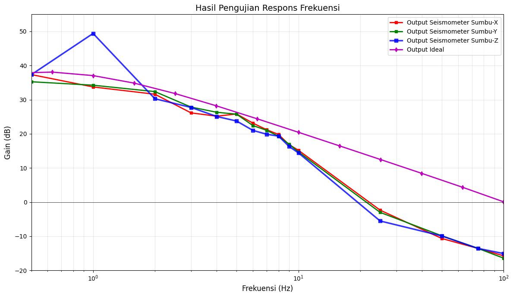
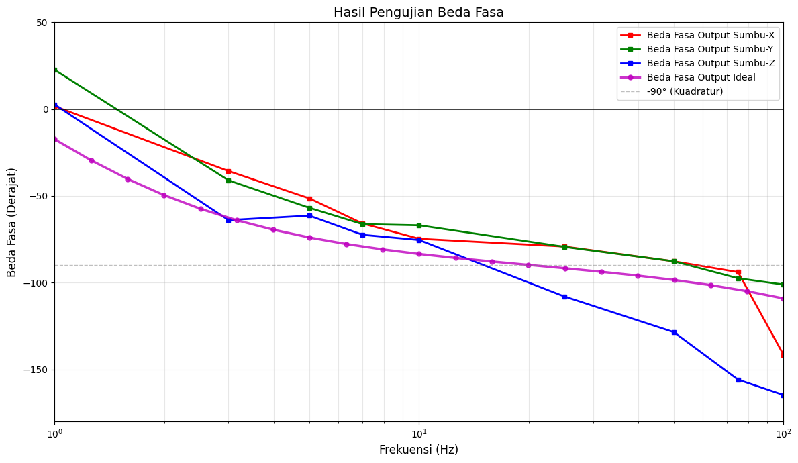

<h1 align="center">
     
    <b>3-Axis Seismometer Based on MMA7361L and MCP6002 for Low-Frequency Seismic Wave Acquisition</b>
     
</h1>

    
    
    
    
    
    

    A seismometer (or geophone) is a device that detects and records seismic wave signals. The mechanism relies on a mechanical part moving due to vibrations, which is then converted into an electrical signal. Normally, a seismometer can cover a wide frequency range (around 1 Hz to 40 Hz with high sensitivity). But the downside? Traditional ones can only detect one axis at a time, and they are super expensive.
      
    Imagine wanting to build a 3-axis seismic detection system for monitoring an active volcano, and you need to place it in multiple locations at once. That would cost a fortune. 
      
    Thus, I built this project to create a seismic wave detector that can <b>detect 3 axes simultaneously (from 0.1 to 100 Hz)</b> on a small, single-board PCB. It's based on the MMA7361L (capacitive MEMS accelerometer) and the MCP6002 (single-supply op-amp). <b>It's small, low-cost, reliable, and easy to manufacture</b>. I really think this could be a breakthrough for any vibration monitoring activities.

<h2 align="center">
    <b>Key Specs</b> 
</h2>

    <b>- Sensor:</b> MMA7361L (Capacitive MEMS Accelerometer)  
    <b>- Signal Processing:</b> MCP6002 single-supply Op-Amp  
    <b>- Frequency Range:</b> 0.1 - 100 Hz (Optimal at 1 - 40 Hz)  
    <b>- Board Size:</b> 5x5 cm (2-layer PCB)  
    <b>- Tools:</b> EasyEDA, JLCPCB, Python, PicoScope, Proteus 8 Professional  

## Table of Contents
- [Schematic](#schematic)
- [PCB Final Product](#pcb-final-product)
- [Testing](#testing)
- [Performance Analysis](#performance-analysis)
- [Conclusion](#conclusion)
- [Recommendation for Future Improvements](#recommendation-for-future-improvements)

## Schematic
I built this 3-Axis Seismometer based on an integrator circuit using an op-amp. It basically acts as a low-pass filter but has a significant slope in its frequency response plot: <b>-20 dB/decade</b>. The circuit also shifts the signal wave phase by <b>90 degrees</b> from its original phase. With this slope and phase shift, the acceleration wave is converted into a proportional velocity wave. But remember, for the integration to work, the signal *must* pass the cut-off frequency value.

    

## PCB Final Product
I designed both the schematic and PCB using EasyEDA (since it's from the same company as JLCPCB). I heavily optimized the PCB layout to keep it as small as possible and improve noise reduction, resulting in a <b>5x5 cm board</b>. The optimizations include <b>the separation of power and analog areas, via stitching, and optimal accelerometer placement</b>.

    

> [!Note]
> Why is the board red? Because it's cool. Why is there a Witcher symbol on the board? Because I like the game.

## Testing
For the testing phase, I placed the seismometer on top of a subwoofer to mimic the vibration of seismic waves with specific frequency values. I needed a power supply circuit and a vibration exciter to energize the subwoofer. 
Besides that, I also tested the board with random frequency vibrations by placing it on a flat surface (like a table) and giving it manual vibrations. The output signal was recorded using a PicoScope and its software on my laptop.

    

## Performance Analysis
I inputted the data from the testing phase into a <b><a href="https://github.com/Satriyo-Wibowo/3-Axis-Seismometer/blob/main/code/gain_phase_analysis.ipynb" target="_blank">Python-based script</a></b> to generate the gain (frequency response) and phase plots. The gain plot shows that the circuit starts integrating the input signal at 1 Hz. However, in the mid-to-high frequency range, the circuit starts to significantly attenuate the signal. I suspect this is due to component limitations.

    

The phase plot shows that the output signal has a tendency to maintain a 90-degree phase shift.

    

## Conclusion
Even though the primary goals of this project were successfully achieved—creating a seismometer that can detect 3 axes simultaneously, is small enough, costs less than a geophone, and is easy to make—the board still has some significant flaws. The integration process only works within a <b>limited frequency range, roughly 1 Hz to 40 Hz</b>. The <b>noise reduction is also not near what was expected</b>, with a lot of noise at the lower and higher frequency ranges. Nevertheless, I believe this project brings us one step closer to a reliable 3-axis seismometer.

## Recommendation For Future Improvements
Honestly, the components I used were not in good condition—such as the accelerometer and the op-amp <b>(they had been refurbished several times, which is crazy, I know!)</b> due to funding limitations. I believe this played a big role in the suboptimal performance of the seismometer. 

I also think the grounding method of the board is not good enough. The analog and power areas are indeed separated by component placement, but the ground plane is still connected in a single plane, rather than separated into different planes and then connected by a via <b>(like the star grounding method)</b>. This could lead to a <b>ground loop phenomenon</b> and worsen the EMI effect. The via stitching only helped the signal have a shorter return path to the ground pad.